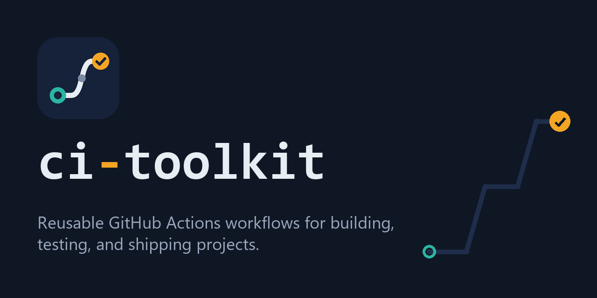

<p align="center"></p>

# ci-toolkit

[](https://tiborhorvath.dev)

Stack-neutral by name, so pipelines for any language can coexist here.

Pin callers to the moving major tag **`@v1`**, or to a commit SHA kept current by
Dependabot. See [Staying up to date](#staying-up-to-date). All third-party actions are SHA-pinned.

## Workflows

### .NET

| Workflow | Purpose | Docs |
|---|---|---|
| `dotnet-build-test.yml` | .NET build + test — build-once/test-in-parallel sharding, coverage, trx report | [docs](docs/dotnet-build-test.md) |
| `nuget-publish.yml` | NuGet pack + push (idempotent, `--skip-duplicate`) | [docs](docs/nuget-publish.md) |
| `dotnet-vulnerable-packages.yml` | NuGet vulnerability check, direct + transitive, fails on findings | [docs](docs/dotnet-vulnerable-packages.md) |
| `dotnet-coverage-comment.yml` | Sticky PR comment with the merged code-coverage summary from `dotnet-build-test` | [docs](docs/dotnet-coverage-comment.md) |

### Node / React

| Workflow | Purpose | Docs |
|---|---|---|
| `node-build-test.yml` | Node/React lint, typecheck, test (sharded) and build — npm/pnpm/yarn auto-detected, script-driven | [docs](docs/node-build-test.md) |
| `node-audit.yml` | Dependency vulnerability audit from the lockfile (npm/pnpm/yarn), severity threshold, prod-only by default | [docs](docs/node-audit.md) |
| `bundle-size.yml` | Builds PR and base, posts gzip/raw size delta as a PR comment, optional size gate | [docs](docs/bundle-size.md) |
| `lighthouse-ci.yml` | Lighthouse CI on the static build with minimum category scores; reports kept private as an artifact | [docs](docs/lighthouse-ci.md) |
| Dependabot template | `dependabot.yml` for Node/React repos — grouped React/tooling/lint updates | [docs](docs/dependabot-node.md) |

### Containers

| Workflow | Purpose | Docs |
|---|---|---|
| `docker-publish.yml` | Docker build + push to any registry (Buildx, GHA cache) | [docs](docs/docker-publish.md) |

### Any stack

| Workflow | Purpose | Docs |
|---|---|---|
| `secret-scan.yml` | Scan commits/PRs for leaked API keys, tokens and connection strings (gitleaks) | [docs](docs/secret-scan.md) |
| `codeql.yml` | CodeQL static analysis, one job per language, results in Code scanning | [docs](docs/codeql.md) |
| `dependency-review.yml` | Blocks PRs that add vulnerable or disallowed-licence dependencies | [docs](docs/dependency-review.md) |
| `pr-title-lint.yml` | Enforces Conventional Commit PR titles (what release-please reads) | [docs](docs/pr-title-lint.md) |
| `pr-title-labels.yml` | Labels PRs from their Conventional Commit title (`type: feat`, `breaking-change`, optional scopes) | [docs](docs/pr-title-labels.md) |
| `pr-path-labels.yml` | Labels PRs from the files they change (`actions/labeler` rules, config file or inline) | [docs](docs/pr-path-labels.md) |
| `dependabot-automerge.yml` | Approves and auto-merges Dependabot PRs within a policy (minor/patch by default); requests review on the rest | [docs](docs/dependabot-automerge.md) |
| `workflow-lint.yml` | actionlint + shellcheck + SHA-pin check for a repo's own workflows | [docs](docs/workflow-lint.md) |
| `stale.yml` | Label and close inactive issues and PRs | [docs](docs/stale.md) |
| `actions-consumption.yml` | Report a run's Actions usage (per OS / per job, optional account balance) | [docs](docs/actions-consumption.md) |
| `.github/actions/cache` | Composite action: NuGet + build-output caching with restore-key fallbacks | [docs](docs/caching.md) |
| `.github/actions/node-setup` | Composite action: package-manager detection, pnpm/corepack, Node + dependency cache, frozen install | [docs](docs/node-setup.md) |

Each doc page lists the workflow's inputs/secrets and copy-paste caller examples.

Contributing? See [CONTRIBUTING.md](CONTRIBUTING.md) for the checks every PR must pass.

## Quick start

```yaml
# .github/workflows/ci.yml
on:
  push: { branches: [main] }
  pull_request: { branches: [main] }
jobs:
  dotnet:
    name: .NET
    uses: tibor-horvath/ci-toolkit/.github/workflows/dotnet-build-test.yml@v1
    with:
      dotnet-version: "10.0.x"
      test-matrix: '["unit","integration"]'
    secrets: inherit
    permissions:
      checks: write
      contents: read
```

## Cancel superseded runs

The CI-style workflows (`node-build-test`, `dotnet-build-test`, `lighthouse-ci`,
`bundle-size`, `codeql`, `dependency-review`, `secret-scan`, `node-audit`,
`dotnet-vulnerable-packages`, `dotnet-coverage-comment`, `workflow-lint`,
`pr-title-lint`, `pr-title-labels`, `pr-path-labels`, `dependabot-automerge`) cancel their own in-flight run when a newer one starts for the same pull request, so a push to a
PR branch no longer leaves the previous run burning minutes. You don't need to
do anything.

- Only `pull_request` / `pull_request_target` runs are cancelled. Runs on
  `main`, schedules and releases always complete.
- Each workflow's group is prefixed with its own name, so it never collides with
  a `concurrency:` group in your calling workflow.
- Opt out per call with `cancel-superseded: false`.
- Calling the same workflow twice in one run with identical inputs (same
  `working-directory` / `project`) would make the calls cancel each other. Give
  them different directories or projects, or set `cancel-superseded: false`.

The publish workflows (`nuget-publish`, `docker-publish`) deliberately don't do
this: cancelling mid-push can leave a half-published package or image. To
cancel superseded runs across your whole caller workflow, or to queue publishes,
add a `concurrency:` block to the caller:

```yaml
concurrency:
  group: ci-${{ github.workflow }}-${{ github.ref }}
  cancel-in-progress: ${{ github.event_name == 'pull_request' }}
```

## Versioning & releases

Consumers pin the moving major tag `@v1`. Releases are automated with
[release-please](https://github.com/googleapis/release-please) (`release.yml`):

1. Push [Conventional Commits](https://www.conventionalcommits.org/) to `main`
   (`feat:`, `fix:`, `refactor:`, `docs:`, …).
2. release-please maintains a **release PR** that bumps the version and updates
   `CHANGELOG.md`.
3. Merging that PR tags `vX.Y.Z`, cuts a GitHub release, and the workflow
   repoints **`v1`** at it — so `@v1` consumers get the change automatically.

`feat:` bumps the minor, `fix:` the patch; a `!` or `BREAKING CHANGE:` footer
bumps the major (and you'd then advertise a `@v2` tag). See `CHANGELOG.md` for
release history.

## Staying up to date

Pick one of two ways to receive new releases.

**Moving tag `@v1`: zero effort, no review.** Every run resolves to the latest
`v1.x.y`, so fixes land without a PR. A bad release also lands straight away,
with no gate. The [`workflow-lint`](docs/workflow-lint.md) pin check flags `@v1`,
so if you use both, set `require-pinned-actions: false`.

```yaml
uses: tibor-horvath/ci-toolkit/.github/workflows/dotnet-build-test.yml@v1
```

**SHA pin + Dependabot: reviewed and reversible (recommended).** Pin the call
to a release commit, keeping the version in a trailing comment:

```yaml
uses: tibor-horvath/ci-toolkit/.github/workflows/dotnet-build-test.yml@<commit-sha> # v1.15.0
```

Then let Dependabot bump it. The `github-actions` ecosystem covers
reusable-workflow calls too. It matches this repo's `vX.Y.Z` tags and updates
both the SHA and the comment:

```yaml
# .github/dependabot.yml
version: 2
updates:
  - package-ecosystem: "github-actions"
    directory: "/"            # scans .github/workflows/**
    schedule:
      interval: "weekly"
    groups:
      ci-toolkit:
        patterns:
          - "tibor-horvath/ci-toolkit*"
```

Each release then arrives as one PR that you can review, test, and revert. This
setup also passes the `workflow-lint` pin check. Renovate supports the same
approach (`helpers:pinGitHubActionDigests`).

**Major versions.** `@v1` never moves to `v2`: switch to `@v2` by hand after
reading the breaking changes in `CHANGELOG.md`. With a SHA pin, Dependabot opens
the major bump as its own PR.
